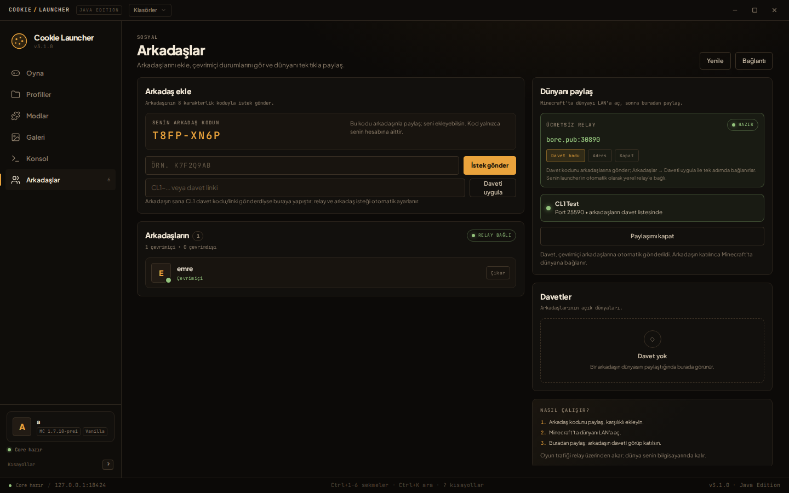

# Arkadaşlar / Sosyal



Cookie Launcher'ın arkadaş sistemi; arkadaş ekleme, çevrimiçi durum, dünya daveti ve
arkadaşın dünyasına tek tıkla katılma akışını içerir. Minecraft sunucusu kurmaz:
dünya host'un bilgisayarında çalışır, oyun trafiği küçük bir relay üzerinden taşınır.

## Bileşenler

| Bileşen | Görev |
| --- | --- |
| `backend/social_relay.py` | Arkadaşlık grafiği, presence, davetler ve TCP tüneli. Tek başına çalışır. |
| `backend/social_client.py` | Launcher backend'inin relay bağlantısı; tünel ve LAN keşfi. |
| `backend/server.py` | `/api/social/*` HTTP uçları; `quickPlayMultiplayer` ile oyuna katılma. |
| `src/` Arkadaşlar sekmesi | Ekleme/çıkarma, istekler, davetler, paylaşım ve bağlantı ayarları. |

## Yerel test

Üç terminal:

```bash
# 1) Relay (varsayılan 19021 control / 19022 tunnel)
python3 backend/social_relay.py --host 127.0.0.1 --control-port 19021 --tunnel-port 19022

# 2) Launcher A
COOKIE_LAUNCHER_DATA_DIR=/tmp/cl-a COOKIE_LAUNCHER_PORT=18421 python3 backend/server.py

# 3) Launcher B
COOKIE_LAUNCHER_DATA_DIR=/tmp/cl-b COOKIE_LAUNCHER_PORT=18422 python3 backend/server.py
```

Tarayıcıda iki istemci:

- `http://127.0.0.1:18421/?api=http://127.0.0.1:18421`
- `http://127.0.0.1:18422/?api=http://127.0.0.1:18422`

`?api=` yalnızca geliştirme/iki istemci testi içindir; normal launcher kendi portunu
otomatik bulur.

## Kullanım

1. iki taraf da **Arkadaşlar → Bağlantı** ekranından aynı relay adresini girer,
2. bir taraf diğerinin 8 karakterlik arkadaş kodunu ekler, karşı taraf kabul eder,
3. Minecraft'ta dünyayı **Esc → LAN'a aç** ile açar,
4. host **Dünyanı paylaş** panelinde LAN dünyasını seçer (ya da portu girer) ve paylaşır,
5. arkadaş **Davetler** kartından **Dünyaya katıl** der; launcher Minecraft'ı
   `quickPlayMultiplayer` ile doğrudan yerel tünel portuna başlatır.

LAN dünyası otomatik bulunamazsa port alanına Minecraft'ın verdiği portu yazın
(varsayılan `25565` değildir; Minecraft rastgele bir port seçer).

## VPS yok: kendi bilgisayarında relay + ücretsiz bore tüneli

VPS veya ödeme istemiyorsan launcher bunu otomatik yapar: **Dünyayı paylaş**'a
bastığında relay yoksa host relay + [`bore`](https://github.com/ekzhang/bore)
(MIT, hesapsız, ücretsiz) tüneli kendiliğinden başlar. Arkadaş listesi/presence
aynı kalır; host launcher'ı açık olduğu sürece relay çalışır.

İlk seferde `bore` binary'si yoksa launcher GitHub'dan indirip platforma uygun
klasöre koyar:

- **Windows:** Harici binary yok; `bore.pub` tüneli saf Python istemcisiyle
  açılır (`share_relay.PythonBoreTunnel`).
- **macOS:** `~/Library/Application Support/CookieLauncher/bin/bore`
- **Linux:** `~/.cookie_launcher/bin/bore`

İstersen önceden `cargo install bore-cli` ile de kurabilirsin. Relay, paketlenmiş
Windows sürümünde ayrı Python gerektirmeden backend içinde çalışır.

**İlk kullanım akışı (CL1):**

1. Host: Arkadaşlar → Dünyayı paylaş. Relay otomatik başlar.
2. Host'ta **Davet kodu** butonu çıkar; `CL1-...` kodunu ve web linkini
   Discord/WhatsApp'a at.
3. Arkadaş: kodu **Daveti uygula** alanına yapıştırır veya panoya kopyalayıp
   launcher penceresine döner (panodan otomatik yakalanır).
4. Launcher relay'i ve arkadaş isteğini otomatik ayarlar; karşı taraf kabul eder.
5. Host dünyayı LAN'a açıp paylaşsın; arkadaş daveti görüp katılır.

`cl://join/CL1-...` desteklenir; WhatsApp/Telegram `cl://`yi engellerse
`https://cookie-launcher.github.io/join/#CL1-...` fallback sayfası kodu kopyalatır.

- **Host launcher**: relay'e otomatik olarak `127.0.0.1:<local>` üzerinden bağlanır.
- **Arkadaşlar**: `bore.pub:<public_control_port>` kullanır.
- Host launcher kapanınca relay kapanır; oyun oynarken açık tut.
- Her açılışta bore portu değişebilir; arkadaşların yeni portu girmeli.
- Host relay ilk kez açıldığında sosyal grafik yeni relay'de başlar; arkadaşların
  bu adrese bağlanıp arkadaş kodlarını yeniden eklemesi gerekir. Relay verisi
  `~/.cookie_launcher/social_relay_host.json` içinde kalır; sonraki açılışlarda
  arkadaşlıklar korunur.
- `bore.pub` trafiği şifrelemez; arkadaş kodları challenge-response ile
  korunur, oyun trafiği Minecraft LAN gibi şifresizdir.
- Tünel girişinde **CLT1 binary HMAC challenge-response** vardır; auth
  tamamlanmadan Minecraft portuna bağlantı açılmaz, ticket tek kullanımlıktır.

Terminalden manuel çalıştırmak istersen:

```bash
python3 backend/share_relay.py
```

Bu, aynı relay'i başlatır ve `RELAY_SHARE` satırında adresi yazdırır.

## Kısa CL1 kodu (Worker)

Kısa `CL1-ROOM-SESSION-EXP-HOSTCODE` kodları için Cloudflare Worker + KV
kullanılabilir. Kurulum: `infra/README.md`.

- Host **Bağlantı → Rendezvous adresi** alanına Worker URL'sini girer.
- Relay açılınca Worker'a `PUT`, 240 sn'de bir heartbeat, kapanırken `DELETE`.
- Worker ulaşılamazsa launcher otomatik olarak uzun (endpoint gömülü) CL1 koduna
  düşer; paylaşım durmaz.
- Arkadaş da aynı Worker URL'sini girmelidir.

## Uçtan uca şifreleme (Noise)

Host ve arkadaş arasındaki Minecraft trafiği `Noise_XX_25519_ChaChaPoly_SHA256`
ile şifrelenir. Relay/bore yalnızca length-prefixed binary frame görür.

- Host statik Noise public key'i uzun CL1 koduna, kısa kodda Worker `npub`
  alanına ve `world_share` oturumuna yazılır.
- Arkadaş host anahtarını davetle pinler; yanlış host anahtarı reddedilir.
- `CLT1` HMAC auth'tan sonra Noise handshake yapılır; Minecraft'a ancak
  şifreli kanal kurulduktan sonra bağlanılır.
- Guest, Noise'un son el sıkışma yüküne `pid`, `ticket_id`, `session_id` ve
  kendi `npub` değerini koyar. Host bunları relay'in `tunnel_request` kaydıyla
  ve guest Noise anahtarıyla karşılaştırır; uyuşmazsa bağlantı reddedilir.
- Frame: `[uint16 length][Noise payload]`.

## P2P öncelikli hibrit (STUN + UDP)

1. Host dünyayı paylaşınca UDP soketi açar, STUN ile dış `IP:port` öğrenir.
2. Guest aynı şekilde kendi adayını bulur; adaylar mevcut arkadaş relay'i
   üzerinden (`world_share` / `world_join`) takas edilir.
3. İki taraf eşzamanlı `CLP1` punch paketleri gönderir; paketler token'dan
   türetilen 8 byte'lık anahtarla doğrulanır.
4. Delme başarılıysa Noise_XX, UDP üzerindeki güvenilir `CLU1` stream üzerinden
   kurulur; Minecraft trafiği doğrudan P2P akar.
5. Punch 3 sn içinde çift yönlü olmazsa veya STUN başarısızsa mevcut şifreli
   bore.pub tüneli kullanılır. Symmetric NAT bu fallback'i tetikler.

`udp_stream.py` KCP benzeri minimal bir reliable UDP katmanıdır: sequence,
kümülatif ACK, 64 paket pencere, RTO retransmit ve sıralı teslim.

## Relay'i internete açma

Relay'i küçük bir VPS'e koyun (yalnızca Python 3 gerekir):

```bash
# Sunucuda
python3 backend/social_relay.py \
  --host 0.0.0.0 --control-port 19021 --tunnel-port 19022 \
  --data /var/lib/cookie-launcher/social_relay.json
```

Güvenlik duvarında **19021/tcp** ve **19022/tcp** açılmalıdır. Launcher'da relay
adresi olarak VPS'in IP'sini, port olarak `19021` girin.

### TLS (önerilir)

Relay, sertifika verilirse hem control hem tunnel bağlantısını TLS ile sunar:

```bash
python3 backend/social_relay.py --host 0.0.0.0 \
  --control-port 19021 --tunnel-port 19022 \
  --tls-cert /etc/letsencrypt/live/relay.example.com/fullchain.pem \
  --tls-key  /etc/letsencrypt/live/relay.example.com/privkey.pem
```

Launcher'da **Bağlantı → TLS kullan** işaretlenir. Sertifika, relay adıyla
eşleşen ve sistem tarafından güvenilen bir sertifika olmalıdır (Let's Encrypt gibi).
TLS kapalıyken relay'e giden trafik şifresizdir; internet üzerinde kullanmayın.

### systemd örneği

```ini
[Unit]
Description=Cookie Launcher social relay
After=network-online.target

[Service]
ExecStart=/usr/bin/python3 /opt/cookie-launcher/backend/social_relay.py \
  --host 0.0.0.0 --control-port 19021 --tunnel-port 19022 \
  --data /var/lib/cookie-launcher/social_relay.json \
  --tls-cert /etc/letsencrypt/live/relay.example.com/fullchain.pem \
  --tls-key  /etc/letsencrypt/live/relay.example.com/privkey.pem
Restart=on-failure
User=cookie

[Install]
WantedBy=multi-user.target
```

## Testler

```bash
python3 -m unittest discover -s backend/tests -v
```

Testler gerçek relay sürecini başlatır; iki/üç istemciyle arkadaşlık, presence,
dünya paylaşımı, iki misafirin aynı anda tünelden bağlanması, relay yeniden
başlayınca arkadaşlığın kalması ve yanlış secret'ın reddedilmesi doğrulanır.

## Sınırlar

- Relay oyun trafiğini taşır; host'un upstream bant genişliği ve relay'in
  bant genişliği önemlidir. P2P değildir.
- Aynı anda tek dünya paylaşılabilir; bir host birden çok misafir alabilir.
- `quickPlayMultiplayer` desteği Minecraft 1.20+ sürümlerinde tam çalışır; daha eski
  sürümlerde oyun açılır ama sunucuya elle bağlanmak gerekebilir.
- Microsoft/Xbox hesabı yoktur; mevcut offline kullanıcı adı akışı kullanılır.
- Minecraft zaten açıksa launcher ikinci bir süreç başlatmaz; davete katılmak için
  oyunu kapatıp tekrar deneyin.
- Aynı sürüm ve mod setini kullanın; launcher mod uyumluluğunu doğrulamaz.
- Relay çalışmazsa arkadaş listesi önbellekten görünür ama yeni istek/davet gitmez.
- Relay operatörü, TLS olsa bile oyun trafiğini görebilir (Minecraft LAN trafiği
  uçtan uca şifreli değildir).
